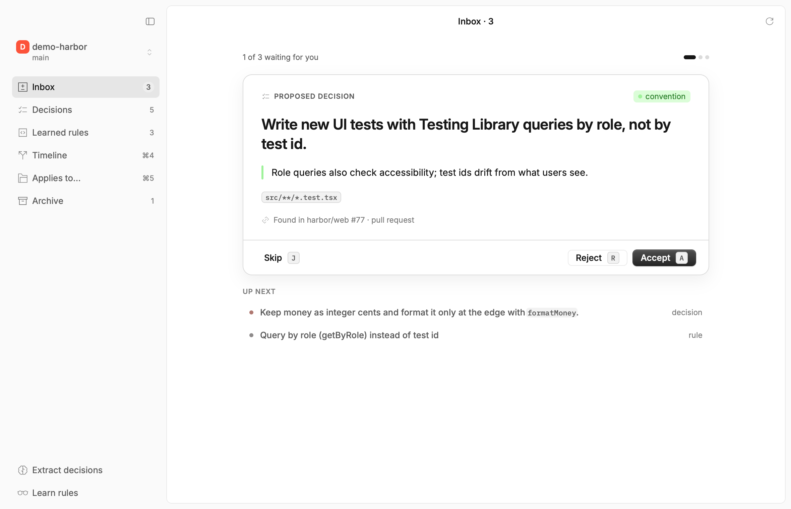

# ingrain

[](https://github.com/WispAgents/ingrain/actions/workflows/ci.yml)
[](https://github.com/WispAgents/ingrain/releases/latest)
[](LICENSE)
[](https://wispagents.github.io/ingrain/)
[](Cargo.toml)

**Problem:** your coding agent keeps breaking what your team already settled. It re-adds the
dependency you removed, brings back the pattern you banned, and repeats the mistake you corrected
last week.

**Solution:** ingrain keeps those rules in your repo, puts the relevant ones in front of the agent
right before it edits a file, and blocks edits, commits and PRs that break them.

Rules come from two places:

- **Decisions** you record (or that `ingrain decisions extract` proposes from your AGENTS.md, PRs,
  reviews, commits and sessions): "billing calls the payments client, never raw fetch", with a
  reason, a scope and optional checks. They live in `decisions/`.
- **Lint rules learned from your corrections**: when you keep fixing the same thing in agent code,
  `ingrain rules mine` and `ingrain rules propose` turn it into an ast-grep rule, tested on your history. They
  live in `.corrections/rules/`.

Nothing becomes a rule without a person accepting it.

**Docs:** [wispagents.github.io/ingrain](https://wispagents.github.io/ingrain/), with guides and a
full [CLI reference](https://wispagents.github.io/ingrain/reference/cli.html).

### Decisions or learned rules?

|                | Decision                                                        | Learned rule                                                        |
|----------------|-----------------------------------------------------------------|---------------------------------------------------------------------|
| Comes from     | Someone saying what code must do, recorded or extracted         | A mistake people kept fixing in agent code, mined from history      |
| Holds          | A sentence, a reason, a scope, optional checks                  | An ast-grep pattern, backtested on past corrections                 |
| Covers         | Anything: architecture, conventions, dependencies, scope        | Only code patterns a lint rule can match                            |
| Enforced       | Shown before edits in scope; with checks, a breaking edit is denied before it lands | Runs after edits, in shadow → warn → block mode, promoted from its hit log |
| Changed with   | `ingrain decisions supersede`                                   | `ingrain rules mode`, `ingrain rules promote`                       |
| Per-line override | A comment naming the decision id ([how](#where-checks-run))      | A comment naming the rule id ([how](#where-checks-run))             |

Use a decision when you can say the rule up front, especially when it isn't about code shape
("don't add Redis", "billing goes through the payments client"). Learned rules cover the rest: the
mistakes nobody wrote down until they had fixed them a few times. Both are accepted by a person,
can't be edited by agents, and are checked together by `ingrain check`, the pre-commit hook and CI.

## Install

```sh
brew install wispagents/tap/ingrain   # macOS and Linux
# or from source, any OS:
cargo install --locked --git https://github.com/WispAgents/ingrain --tag v0.3.0 ingrain
```

Prebuilt binaries for macOS, Linux and Windows (x64 and arm64) are on the
[releases page](https://github.com/WispAgents/ingrain/releases/latest). On Windows, unzip
`ingrain.exe` into a folder on your `PATH`. Claude Code runs hooks through Git Bash there, and
Git for Windows runs the pre-commit hook, so both work as on macOS and Linux.

Needs `git`. Optional: `gh` (logged in) to read GitHub PRs, reviews and issues; Claude Code
(`claude`) or `ANTHROPIC_API_KEY` for extraction and for rules templates can't express.

## Use it from your coding agent

With `ingrain` installed, give your agent the ingrain skills, then ask it to **"set up ingrain in
this repo"**. The `ingrain-setup` skill runs `ingrain init` (and installs the binary first if it's
missing, after asking), turns the rules in your AGENTS.md / CONTRIBUTING.md into decisions for
you to approve, and commits on a branch.

**Claude Code** (plugin: skills + hooks):

```
/plugin marketplace add WispAgents/ingrain
/plugin install ingrain@ingrain
```

**Any agent** (Claude Code, Codex, Cursor, Copilot, Gemini CLI, opencode and
[more](https://github.com/vercel-labs/skills)):

```sh
npx skills add WispAgents/ingrain
```

| Skill | Use it for |
|---|---|
| `ingrain-setup` | Install and set up ingrain in a repo, seed decisions from your docs |
| `ingrain-decide` | "From now on we don't use X": record, change or look up a decision |
| `ingrain-rules` | Learn rules from past corrections, review them, set shadow / warn / block |

The plugin's hooks act only in repos set up with `ingrain init`, and step aside where the repo's
own `.claude/settings.json` already runs ingrain (no double checks). Without the `ingrain` binary
they do nothing. Agents without hooks get an ingrain section in AGENTS.md (`ingrain init --agents-md`) and are caught by pre-commit and CI.

## Quick start

```sh
cd your-repo
ingrain init      # decisions/, .corrections/, Claude Code hooks, git pre-commit hook

ingrain decisions add "Billing code calls the payments client, never raw fetch." \
  --reason "the client adds idempotency keys" \
  --scope "src/billing/**" \
  --forbid-pattern 'TypeScript:fetch($$$A)'

ingrain decisions extract --doc AGENTS.md   # propose decisions from your rules doc, PRs, commits, sessions
ingrain decisions review                    # accept / edit / reject

ingrain rules mine --pr-refs --github       # capture corrections of agent code
ingrain rules propose --explain             # learn and backtest lint rules from them
ingrain rules review                        # accept / edit / reject

git commit decisions/ .corrections/ -m "ingrain rules"
```

## See it: the viewer

`ingrain viewer` opens a desktop app on the repository you are in. Use it to read what was decided
and why, review proposals, and see how things changed.



- **Inbox**: proposals one at a time. `A` accepts, `R` rejects with a reason, `J` skips.
- **Decisions**: each one with why, what was not chosen, where it applies, the check that enforces
  it, where it was decided, what it replaced, and its git history with each change's diff.
- **Learned rules**: set the mode (shadow, warn, block), see hits per week, overrides, the fix the
  rule learned from and its backtest.
- **Timeline**: every decision by month. Replaced ones are struck through and point to the new one.
- **Applies to…**: type a path, or drop a file on the window, to see what an agent gets for it.
- **Stores**: project, local and global decisions and rules show together, tagged; the sidebar
  filters by store once you have personal ones.
- Open it from anywhere: `ingrain viewer ~/code/app`; outside a repository it lists your recent
  ones. `ingrain --global viewer` shows only your personal rules. Drop a folder on the window to
  open it.

The window updates by itself when files change. Every change it makes (accept, reject, supersede,
mode) runs `ingrain`'s own commands, so it does exactly what they do. It is part of the `ingrain`
binary, built with [Rune](https://github.com/anomalyco/rune); `ingrain viewer` returns at once and
the window keeps running (`--wait` keeps the terminal until it closes).

On Linux, the prebuilt binaries leave the viewer out, so `ingrain` runs in any container or CI
image with nothing extra installed. For the viewer on a Linux desktop, build from source (Rust 1.99
or newer, plus `libxkbcommon-dev` and `libwayland-dev`):
`cargo install --locked --git https://github.com/WispAgents/ingrain ingrain`.

## Just for you: local and global stores

Decisions and rules don't have to be committed. Two personal stores sit next to the project's
`decisions/` and `.corrections/`, and are never written to the working tree:

| Store | Where | Applies to | Decision ids |
|---|---|---|---|
| project (default) | `decisions/`, `.corrections/` | the repository, shared with the team | `D-0001` |
| `--local` | `.git/ingrain/local/` | this repository, for you only | `L-0001` |
| `--global` | `~/.config/ingrain/` (`$INGRAIN_HOME`, `$XDG_CONFIG_HOME/ingrain`, `%APPDATA%\ingrain`) | every repository on this machine | `G-0001` |

```sh
# Use ingrain in a repo without committing anything
ingrain init --local      # .git/ingrain/local/, hooks in .claude/settings.local.json (git-excluded)
ingrain decisions add "Use the fetch wrapper, not axios." --forbid-dep axios   # → L-0001

# Your own rules, everywhere
ingrain init --global     # ~/.config/ingrain/, hooks in ~/.claude/settings.json ($CLAUDE_CONFIG_DIR)
ingrain --global decisions add "Prefer early returns over nested ifs."        # → G-0001
ingrain --global rules propose                                                 # learned rules go there too
```

Hooks, `ingrain check`, `decisions for` and `decisions list` read all three stores together.
`--local` / `--global` pick where new decisions and rules are written; without a flag, writes go to
the project store when the repo has `decisions/` or `.corrections/`, else to the local store once
`ingrain init --local` ran. `supersede`, `accept`, `reject` and `show` find the store from the id.

- The hooks `init --global` adds to your Claude Code settings work like the plugin's: they answer
  only in repositories set up for ingrain (any global decision counts) and step aside where the
  repository's own settings run ingrain. They aren't added when that settings file enables the
  ingrain plugin; if you enable the plugin elsewhere, pass `--no-claude`.
- Personal stores aren't in git, so the pre-commit check reads them as they are (the project's
  decisions are still read from the base revision), and CI never sees them. `init --local` installs
  the pre-commit hook in that repository; `init --global` installs it only in the repository you run
  it from, if any, so elsewhere global decisions are enforced by the Claude Code hooks alone.
- A repository that only sees your global decisions keeps its own `decisions/` folder editable.
- Agents can't edit accepted files in personal stores, accept proposals there, or run
  `init --local` / `init --global` without asking you; they propose, and you accept. There is no
  first-setup exception for personal stores.
- `$INGRAIN_HOME` and `$XDG_CONFIG_HOME` must be absolute paths; relative ones are ignored.

## What the agent sees (Claude Code)

`ingrain init` adds one hook command per event to `.claude/settings.json` (`ingrain hook <event>`).
Each is a no-op for teammates who don't have ingrain installed, and all of them fail open.

| Hook | What happens |
|---|---|
| `SessionStart` | Repo-wide decisions go into the session, plus how to propose a new one |
| `PreToolUse` on Edit / Write / MultiEdit / NotebookEdit | The edit is simulated first. If an added line breaks a decision's check, the edit is **denied** with the decision and the way out. An edit that adds an `ingrain-ignore` / `decisions-ignore` comment asks the person first. Otherwise the decisions scoped to that file are shown, each once per session |
| `PreToolUse` on Bash | A command that could write accepted decisions, rules or `.corrections/config.yml` (`sed -i`, `>`, `mv`, `rm`, …), or that accepts, rejects or retunes them (`ingrain rules mode`, `ingrain decisions accept`, …), or `git commit --no-verify`, asks the person first |
| `PostToolUse` on Edit / Write / MultiEdit / NotebookEdit / Bash | Learned rules run on the edited file, or on the files the shell command changed (decisions too, since a command can't be simulated). Warn: a note to the agent. Block: the agent must fix it, with the past human fix shown |
| `Stop` | Rules and decisions are re-checked on the files this session edited. Something broken sends the turn back, up to `stop_max_attempts` times; after that the turn ends and the person is told |

Agents can't edit accepted decisions, rules or `.corrections/config.yml` (a broken config falls back
to the defaults in hooks, so it can't switch them off); they propose with `ingrain decisions add --propose`
or `ingrain decisions supersede`, and a person accepts. The one exception is first setup: until a
commit on any branch holds a decision, rule or ingrain config, the agent setting ingrain up may accept
proposals and commit them, so "set up ingrain in this repo" finishes in a headless session too. People
review that commit like any other; `--no-verify` is still asked.

Tested live with Claude Code 2.1.322: asked to write raw `fetch` in `src/billing/`, the write was
denied before the file changed, and the agent explained the decision instead of working around it.

## Where checks run

`ingrain check` runs learned rules and decision checks together, on **added lines only**, so
existing code never blocks.

| Path | Command | On a hit |
|---|---|---|
| Commit | `ingrain check --staged` (`.git/hooks/pre-commit`) | the commit fails |
| Pull request | `ingrain check --diff base...HEAD --format github` ([action](action/action.yml)) | annotations; failing check |
| By hand | `ingrain check [paths]` | listed; exit 1 if something blocks |

Pre-commit and CI judge a change by the decisions, learned rules and config it started from, so a
branch can't retire a decision, delete a rule, set it to shadow or ignore its path, and break it in
the same diff. CI also flags any change to `decisions/` or `.corrections/`. Outside pull requests
the Action compares with the default branch. The pre-commit hook goes where git runs hooks
(`core.hooksPath`, or the main `.git/hooks` from a worktree).

To keep a line on purpose, add a comment with a reason, on the line or the line above:

```ts
// ingrain-ignore avoid-fetch-call: this endpoint streams the response body
// decisions-ignore D-0001: webhook replay needs raw fetch
const res = await fetch(url);
```

Without a reason it doesn't count. On the line above, only a line that is just the comment counts.
An agent adding one is asked to get the person's approval, and CI shows every override on added
lines as a warning annotation. Overrides are logged; `ingrain rules promote` and
`ingrain decisions stale` flag rules and decisions that are overridden often.

## Decisions

One YAML file per decision, `decisions/D-0001.yml`, reviewed like code:

```yaml
id: D-0001
decision: Billing code calls the payments client, never raw fetch.
reason: the client adds idempotency keys
rejected:
- a shared fetch wrapper per module
scope:
- src/billing/**          # path globs, or symbol / module names like `apiClient`
category: convention      # convention | constraint | api_change | architecture | scope
status: accepted          # accepted | superseded (proposals live in decisions/pending/)
checks:                   # optional; without checks a decision is shown, not enforced
  forbid_imports: [axios]
  forbid_deps: [redis]    # package.json, pyproject.toml, requirements*.txt, Cargo.toml, go.mod
  forbid_patterns:
  - language: TypeScript
    pattern: fetch($$$A)  # ast-grep pattern
sources:
- https://github.com/acme/app/pull/214
```

A glob scope matches the path; a bare directory means everything under it. A symbol matches files
whose path names it or whose content mentions it. No scope, or `**`, is repo-wide.

To change one: `ingrain decisions supersede D-0002 --decision "..." --reason "..."`, then
`ingrain decisions review`. The old decision stays in force until a person accepts the new one.

`ingrain decisions extract` reads texts it hasn't read before, oldest first, 400 per run: your
`--doc` files (AGENTS.md, CONTRIBUTING.md), commit messages, GitHub PRs, reviews, issues and
comments by the repo's owners, members and collaborators, and what you typed in Claude Code
sessions for this repo. A model returns proposals; near-duplicates of existing, pending or rejected
decisions are dropped. Measured on public repos, 82% of extracted records were real, durable
decisions ([docs/ledger-study](docs/ledger-study/report.md)).

## Learned rules

| Source | Signal |
|---|---|
| Git fix-ups (`ingrain rules mine`) | A human commit rewrites lines an agent commit added, within `window_days` |
| PR refs (`--pr-refs`) | Same, on `refs/pull/*/head`, so fix-ups inside PRs survive squash merges |
| Review suggestions (`--github`) | A ```` ```suggestion ```` comment on agent-written lines |
| Claude Code transcripts | The agent edits, you reply, the agent rewrites what it just wrote |

`ingrain rules propose` clusters corrections by what they removed, writes rules (templates first, then a
model), and keeps a rule only if it catches the past mistakes, spares the fixed versions, and
isn't contradicted by agent code humans kept (the fix a rule came from never counts as its own
evidence). One correction is enough to propose a rule, even with no other agent code to test on, so a first
run has something to review. Each rule says whether it's from a single fix or repeated fixes.
Single-fix rules that look like one-offs are held back and listed with the reason: the code is
still used 5+ times today, the name is generic (`r3`, `data`, `.append(`), or every fix was in
test code; `--all` keeps them. Pass
`--min-corrections 3` (or set `min_support` in `.corrections/config.yml`) to wait for a mistake to
repeat. Accepted rules start in shadow mode; `ingrain rules promote` moves them to warn and block
from their hit log. Shadow hits are invisible to the agent, so leaving shadow needs hits a human
later corrected (at least 3, and half of all hits, per the mined corrections); `ingrain rules mode
<id> warn` moves one by hand. `ingrain rules eval` measures the whole loop on your history.

## Commands

| | |
|---|---|
| `init [--local \| --global]` | Create `decisions/` and `.corrections/` (or a personal store), install hooks |
| `--local`, `--global` | Before any command: write to the local or global store instead of the project's |
| `check [paths] [--staged \| --diff RANGE] [--format text\|json\|github]` | Rules and decisions on added lines |
| `decisions add \| extract \| review \| accept \| reject \| supersede \| list \| show \| for \| stale` | The decision ledger |
| `rules mine \| propose [--explain] [--min-corrections N] \| review \| accept \| reject \| list \| mode \| promote \| eval` | Learned rules |
| `viewer [path] [--select ID] [--wait]` | Open the desktop viewer (`--global viewer`: your personal rules) |
| `hook <session-start\|pre-tool-use\|post-tool-use\|stop>` | Claude Code hook entry point |

## CI

```yaml
# .github/workflows/ingrain.yml
on: pull_request
jobs:
  check:
    runs-on: ubuntu-latest
    steps:
      - uses: actions/checkout@v4
        with: { fetch-depth: 0 }
      - uses: WispAgents/ingrain/action@v0.3.0
```

## Layout

```
decisions/D-NNNN.yml       accepted decisions          committed
decisions/pending/         proposed decisions          gitignored
.corrections/rules/        accepted learned rules      committed
.corrections/pending/      proposed rules              gitignored
.corrections/config.yml    thresholds, agent markers   committed
.git/ingrain/              corrections, hit logs, hook sessions, extraction state (local)
.git/ingrain/local/        --local store: decisions/L-NNNN.yml, corrections/rules/ (never committed)
~/.config/ingrain/         --global store: decisions/G-NNNN.yml, corrections/rules/ (every repo)
```

## Development

```sh
cargo fmt --all --check
cargo clippy --all-targets --locked -- -D warnings
cargo test --all --locked
```

Crates: `core` (data model, rule files, git), `engine` (ast-grep), `learn` (capture, cluster, rule
writing, backtest, eval), `ledger` (decisions, scope, checks, extraction), `cli` (the `ingrain`
binary). [PLAN.md](PLAN.md) is the working plan.

The viewer is `crates/cli/src/viewer/`, behind the default `viewer` feature: it needs Rust 1.99
(Rune) and, on Linux, `libxkbcommon-dev` and `libwayland-dev`. `--no-default-features` builds the
CLI alone, on Rust 1.90. `python3 scripts/viewer-demo-repo.py /tmp/harbor` builds a
demo repository to try it on; [docs/viewer/PLAN.md](docs/viewer/PLAN.md) has its user stories.

See [CONTRIBUTING.md](CONTRIBUTING.md) before opening a PR, [SECURITY.md](SECURITY.md) to report a
vulnerability, and [CHANGELOG.md](CHANGELOG.md) for release notes. This project follows a
[Code of Conduct](CODE_OF_CONDUCT.md).

License: Apache-2.0.
