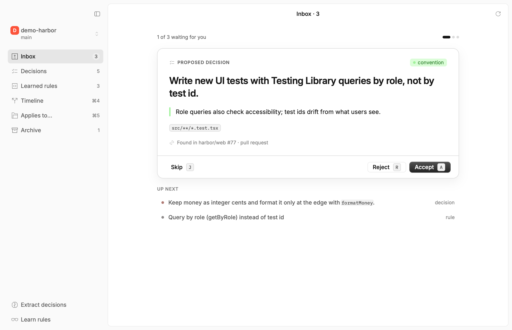
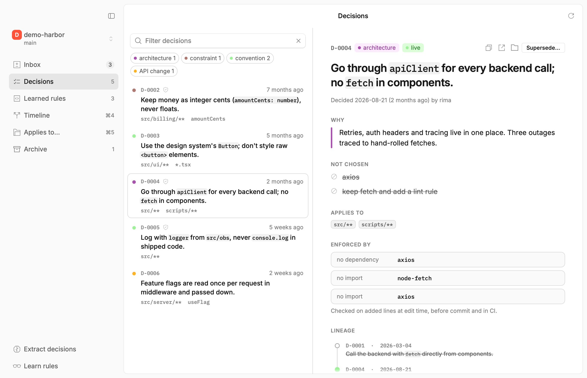
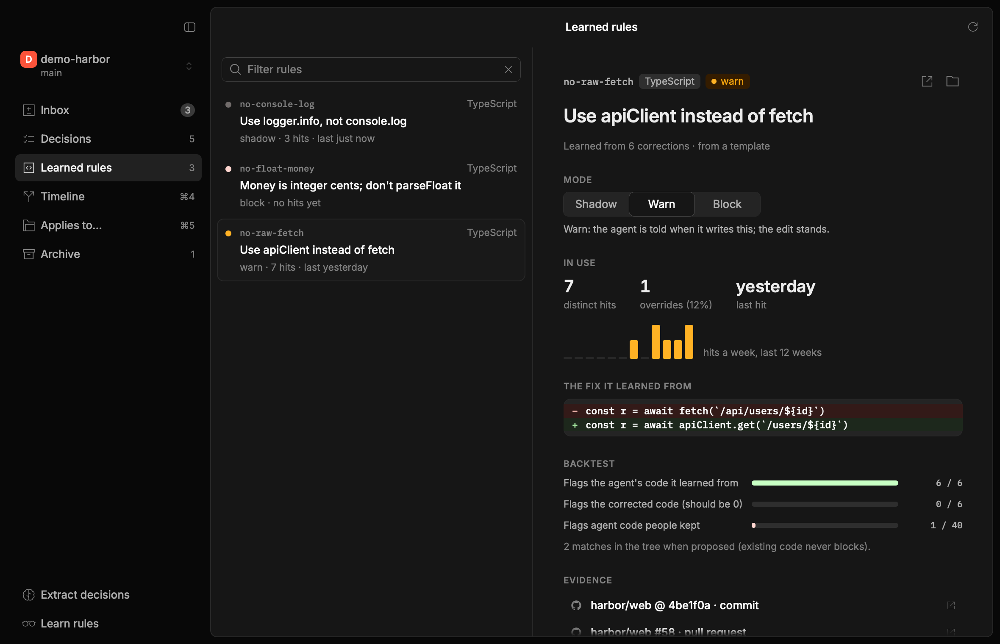
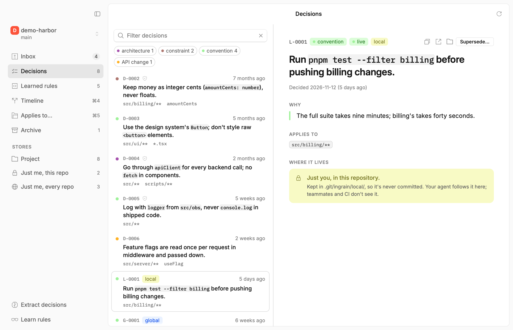
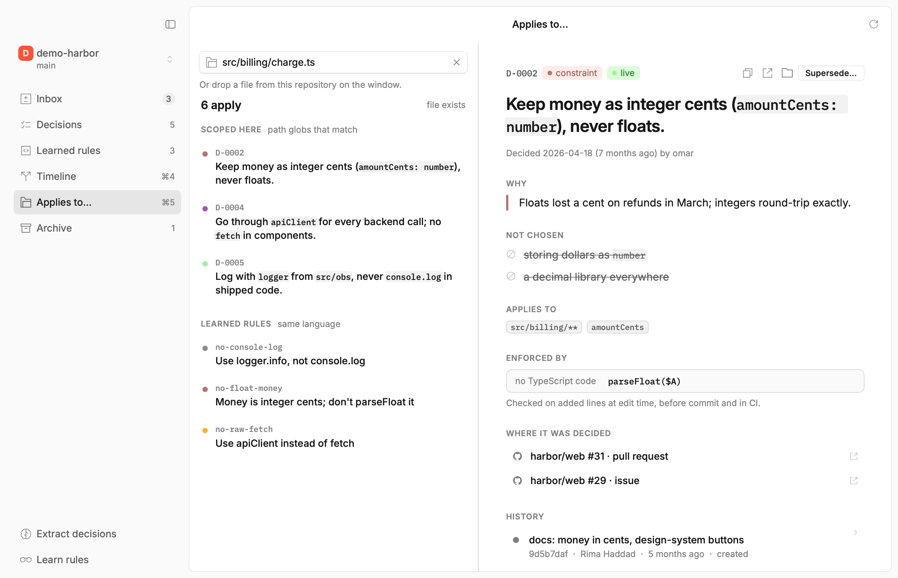

# The viewer

`ingrain view` opens a desktop app on the repository you are in. It shows the same files the CLI
reads: `decisions/`, `.corrections/`, your local and global stores, and the hit log.



## Open it

```sh
ingrain view                    # the repository you are in
ingrain view ~/code/app         # another one
ingrain view --select D-0004    # straight to one decision
ingrain --global view           # only your personal rules
ingrain-viewer                  # no repository: pick a recent one
```

You can also press ⌘O to pick a folder, or drop a folder on the window. Outside a repository,
`--global view` shows your personal rules read-only: the CLI makes changes from inside a
repository, so open the viewer from one to accept or reject them.

## Review proposals

The **Inbox** shows proposals one at a time, decisions and rules together. A replacement shows the
decision it retires, struck through, above the new one. A proposed rule shows the fix it learned
from and its backtest.

| Key | Does |
| --- | --- |
| `A` | Accept |
| `R` | Reject. Type why, then Return. Extraction won't propose it again. |
| `J` / `K` | Next / previous |
| Esc | Cancel a reject |

**Extract decisions** and **Learn rules** at the bottom of the sidebar run `decisions extract`
and `rules mine` + `rules propose`. Their output shows while they run, and new proposals land in
the inbox.

## Read a decision



A decision's page shows, top to bottom: the decision; why; what was not chosen; where it applies
(click a path to see everything else that applies there); the check that enforces it, if any;
its lineage (what it replaced and what replaced it); where it was decided (links open in your
browser); and its git history. Click a commit to see what it changed.

The buttons at the top copy the line agents get, open the file, show it in its folder, or
**Supersede…** it. Superseding writes a proposal. It replaces the decision once someone accepts it.

## Rules



Set a rule's mode with the Shadow / Warn / Block control. The page shows distinct hits, overrides,
the last hit and hits per week for the last 12 weeks, from `.git/ingrain/hits.jsonl`.

## Project, local and global

The viewer reads all three stores at once: the project's (`decisions/`, `.corrections/`), yours for
this repository (`--local`, `L-` ids) and yours for every repository (`--global`, `G-` ids).
Personal items carry a `local` or `global` tag, and their page says where they are kept and who
they reach instead of showing git history (they are never committed). Once you have any, the
sidebar shows **Stores** with a count for each: click one to see only that store in every lens.



## When and where

- **Timeline** lists every decision by the month it was made. Replaced ones are hollow and struck
  through, with an arrow to the new one.
- **Applies to…** takes a path (or a file dropped on the window) and lists the decisions scoped
  there, the ones that match a symbol in the file, the learned rules for its language, and the
  repo-wide ones. The decisions are the ones `ingrain decisions for <path>` gives agents.
- **Archive** lists replaced decisions.



## Keys

| Key | Does |
| --- | --- |
| ⌘1 … ⌘6 | Inbox, Decisions, Learned rules, Timeline, Applies to, Archive |
| ↑ ↓ or `J` `K` | Move through the list |
| `/` or ⌘F | Filter |
| ⌘O | Open a repository |
| ⌘R | Reload |
| ⇧⌘B | Show or hide the sidebar |

On Windows and Linux, ⌘ is Ctrl.

## How it works

The viewer reads files with the same code as the CLI, on a background thread, and checks for
changes every second. Every change it makes runs the `ingrain` CLI (found in `$INGRAIN_BIN`, next
to the viewer, or on `PATH`), one at a time, so it does exactly what the commands do and nothing
more. A file that doesn't parse shows as a warning in the sidebar instead of disappearing.
Sources open in your browser, or in their default app when they are documents or code inside the
repository; nothing else opens.

It is a separate program, `ingrain-viewer`, so the `ingrain` binary that runs in hooks and CI stays
small. Install it with Rust 1.99 or newer:

```sh
cargo install --locked --git https://github.com/WispAgents/ingrain ingrain-viewer
```
